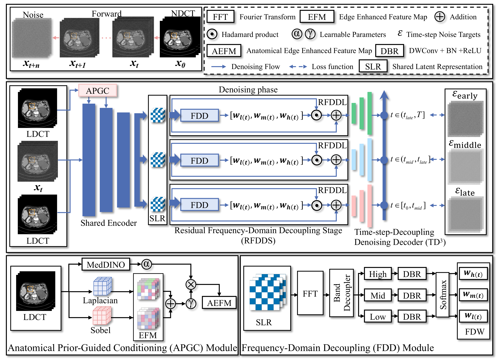

<div align="center">

# ProSAC-CT

**Progressive Spectral-Anatomical Co-Guided Multi-Stage Diffusion Model for Low-Dose CT Denoising**

Xuepeng Liu, Zetong Liu, Renyiming Li, Yan Li, Ruiyu Li, Ruili Li, Jiayi Ding, Eichi Takaya

[[arXiv]](https://arxiv.org/abs/2607.01756) &nbsp; [English](#overview) | [中文](#中文说明)

</div>

<p align="center"></p>

## Overview

ProSAC-CT treats low-dose CT (LDCT) denoising as a residual diffusion process conditioned on a three-slice LDCT observation. The centre slice gives the residual target and the anatomical prior. The two adjacent slices enter the shared encoder together with the current diffusion state.

- **APGC (Anatomical Prior-Guided Conditioning).** Two maps are computed from the centre LDCT slice:
  - an anatomical feature map (AFM) from frozen MedDINOv3;
  - an edge feature map (EFM) from Sobel + Laplacian operators.

  They are fused as (α ⊙ AFM) ⊙ (γ ⊙ EFM) and injected into the shared encoder.
- **RFDDS (Residual Frequency-Domain Decoupling Stage).** Three parallel layers act on the shared latent representation, one per stage. Each layer:
  - splits the representation into low-, middle- and high-frequency radial bands;
  - estimates channel-wise band weights from the bands themselves (DWConv-BN-ReLU, pooling, softmax);
  - adds the re-weighted bands back residually.
- **TD³ (Time-step-Decoupled Denoising Decoder).** Each time-step range has its own decoder that predicts the residual and the noise:
  - early (0.7T, T];
  - middle (0.3T, 0.7T];
  - late [0, 0.3T].

  The stage-wise loss is L2 on the residual, the noise and the recovered NDCT image, with weights (1, 1, 0.1).

## Getting started

**Environment.** Python ≥ 3.8 and a CUDA GPU. Install the dependencies:

```bash
pip install -r requirements.txt
```

**MedDINOv3.** Clone [MedDINOv3](https://github.com/ricklisz/MedDINOv3) into `MedDINOv3/`. Place the ViT-B/16 CT-3M checkpoint ([Hugging Face](https://huggingface.co/ricklisz123/MedDINOv3-ViTB-16-CT-3M)) at `MedDINOv3/MedDINOv3-ViTB-16-CT-3M/model.pth`. Other locations can be set with `MEDDINOV3_REPO` and `MEDDINOV3_CKPT`.

**Data.** Clip CT slices to the window [-160, 240] HU, scale them to [0, 1], and save them as 8-bit grayscale images. Put eight text files in one folder, one image path per line, with the lists aligned line by line:

| File | Content |
|---|---|
| `{split}_ndct.txt` | centre NDCT slice (target) |
| `{split}_ldct.txt` | centre LDCT slice |
| `{split}_ldct_prev.txt` | previous adjacent LDCT slice |
| `{split}_ldct_next.txt` | next adjacent LDCT slice |

Here `split` is `train` or `test`. At the first or last slice of a volume, repeat the centre slice as the missing neighbour. Slices are resized to 128 × 128.

**Train / test**

All settings live in `config.py`, including the module switches. `train.py` and `test.py` both read them, so a test always uses the architecture the model was trained with. Set a switch to `False` for the corresponding ablation:

```python
use_apgc = True    # APGC: anatomical prior from the centre LDCT slice, injected into the shared encoder
use_rfdds = True   # RFDDS: per-stage frequency decoupling on the shared latent representation
use_td3 = True     # TD3: one decoder per time-step stage (False: one decoder for all time steps)
```

```bash
python train.py --data_dir data/lists
python test.py  --data_dir data/lists --checkpoint results/prosac_ct/model-100000.pt --save_dir results/test
```

Training defaults: Adam with learning rate 2e-4, batch size 4, 100k iterations and EMA 0.995. Inference evaluates the network at t = 999, 899, …, 99 and returns the final NDCT estimate. `test.py` reports PSNR / SSIM and saves the denoised slices.

```
config.py            # module switches and hyperparameters
prosac/
├── unet.py          # shared encoder with APGC, RFDDS, TD3 decoders
├── diffusion.py     # residual diffusion, stage-wise training loss, deterministic sampler
├── modules/         # APGC, RFDDL, MedDINOv3 encoder, Res2Net and U-Net blocks
├── trainer.py       # training loop, EMA, evaluation
└── data.py, metrics.py, visualize.py
```

## Citation

```bibtex
@article{liu2026prosacct,
  title   = {ProSAC-CT: Progressive Spectral-Anatomical Co-Guided Multi-Stage Diffusion Model for Low-Dose CT Denoising},
  author  = {Liu, Xuepeng and Liu, Zetong and Li, Renyiming and Li, Yan and Li, Ruiyu and Li, Ruili and Ding, Jiayi and Takaya, Eichi},
  journal = {arXiv preprint arXiv:2607.01756},
  year    = {2026}
}
```

## Acknowledgements

This code builds on several open-source projects:
- [RDDM](https://github.com/nachifur/RDDM) for the residual diffusion process;
- [denoising-diffusion-pytorch](https://github.com/lucidrains/denoising-diffusion-pytorch) for the U-Net blocks;
- [MedDINOv3](https://github.com/ricklisz/MedDINOv3) for the anatomical encoder.

---

## 中文说明

ProSAC-CT 把低剂量 CT（LDCT）去噪建模为残差扩散过程，条件是三张相邻的 LDCT 切片。中心切片提供残差目标和解剖先验；两张相邻切片与当前扩散状态一起输入共享编码器。

- **APGC（解剖先验引导条件）**：从中心 LDCT 切片计算两张图：
  - 冻结 MedDINOv3 提取的解剖特征图（AFM）；
  - Sobel 和 Laplacian 算子得到的边缘特征图（EFM）。

  两者按 (α ⊙ AFM) ⊙ (γ ⊙ EFM) 融合后，注入共享编码器。
- **RFDDS（残差频域解耦阶段）**：在共享潜在表示上并行设置三个解耦层，每个阶段一个。每一层：
  - 把表示分成低、中、高三个径向频段；
  - 由频段本身估计通道级权重（DWConv-BN-ReLU、池化、softmax）；
  - 把加权后的频段以残差方式加回。
- **TD³（时间步解耦去噪解码器）**：每段时间步各用一个解码器，预测残差和噪声：
  - 早期 (0.7T, T]；
  - 中期 (0.3T, 0.7T]；
  - 后期 [0, 0.3T]。

  分阶段损失为残差、噪声和重建 NDCT 三项的 L2，权重为 (1, 1, 0.1)。

**使用方法**
1. 安装依赖：`pip install -r requirements.txt`。
2. 按上文 *MedDINOv3* 一段准备代码和权重。
3. 准备数据：CT 先截断到 [-160, 240] HU，再归一化到 [0, 1]，存成 8 位灰度图。在 `data_dir` 下放八个列表文件，即上表中的 `ndct`、`ldct`、`ldct_prev`、`ldct_next`，训练和测试各一套，各列表按行对应。卷首、卷尾缺少的相邻切片用中心切片代替。
4. 所有设置都在 `config.py` 中，train.py 和 test.py 共用。
   - 模块开关为 `use_apgc`、`use_rfdds`、`use_td3`，设为 `False` 即对应的消融实验。
   - 默认设置：Adam，学习率 2e-4，batch size 4；推理在 t = 999, 899, …, 99 处评估。
5. 训练和测试的命令同上。
